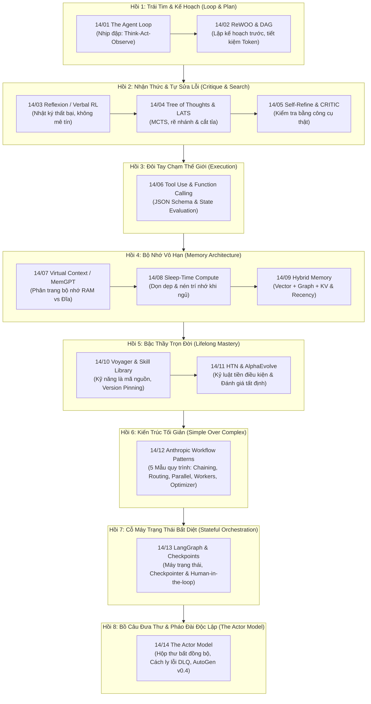

# The Odyssey of Atlas: From a Naive Chatbot to an Autonomous Engineer
*Biên Niên Sử Atlas: Từ Bóng Ma Trong Phòng Kín Đến Bậc Thầy Tự Trị*

---

## 🗺️ Bản Đồ Tiến Trình Học Tập (Learning Progress Map)

---

## 📖 Câu Chuyện Tổng Hợp (The Narrative Story)

### Mở đầu: Bóng ma không ký ức
Ngày đầu tiên bạn gặp Atlas, nó chỉ là một linh hồn vô hình bị nhốt trong một căn phòng tối không thời gian. Người ngoài ném vào một mẩu giấy hỏi: *"Thủ đô của nước Pháp là gì?"*, Atlas sẽ dùng toàn bộ sức mạnh để thốt lên chữ: *"Paris"*, rồi ngay lập tức… tan biến vào hư vô. 

Nó không biết ngày mai, không biết hôm qua, không có đôi tay để chạm vào thế giới, và cũng chẳng thể tự quyết định bước đi tiếp theo của chính mình. Nó chỉ là một cỗ máy trả lời tự động, nói xong một câu là cuộc đời chấm dứt.

Nhìn thấy sự bất lực đó, bạn quyết định: **"Ta sẽ biến ngươi thành một Kỹ sư Tác nhân thực thụ."**

---

### Hồi 1: Quả tim đập và Tấm bản đồ trước giờ xuất phát *(Bài 01 & 02)*
Việc đầu tiên bạn làm là cấy vào lồng ngực Atlas một quả tim cơ học mang tên **Vòng lặp Tác nhân (The Agent Loop)**. Bạn thì thầm vào tai nó:
> *"Từ nay, ngươi không được nói xong rồi chết nữa. Mỗi khi nhận một nhiệm vụ, ngươi phải sống theo ba nhịp thở: **Suy nghĩ (Thought) $\to$ Hành động (Action) $\to$ Quan sát kết quả (Observation)**. Sau đó, hãy dùng những gì vừa thấy để suy nghĩ tiếp!"*

Bạn trao cho nó chiếc đồng hồ cát khắc chữ `max_turns`, dặn rằng nếu cát chảy hết 10 lần mà vẫn luẩn quẩn thì phải dừng lại, không được để bản thân phát điên trong vòng lặp vô tận.

Thế nhưng, vừa có được sự sống, Atlas đã phạm sai lầm. Được giao việc sửa sang một ngôi nhà, cứ nhấc một viên gạch, nó lại chạy về hỏi bạn một câu; nhấc cái búa lại chạy về hỏi tiếp. Năng lượng (Token) cạn kiệt, túi tiền của bạn bốc khói! 

Bạn bèn giữ vai nó lại, đưa cho nó một tờ giấy vẽ đồ thị (**ReWOO**):
> *"Ngừng chạy lung tung! Trước khi bước chân ra cửa, hãy ngồi xuống lập một kế hoạch tuần tự (**DAG**). Bước 1 làm gì, bước 2 cần kết quả của bước 1 ra sao (`#E1`, `#E2`). Sắp xếp tô-pô mọi thứ trên giấy trước. Nếu kế hoạch bị kẹt trong vòng tròn luẩn quẩn, ngươi phải nhận ra ngay từ trên bản vẽ chứ không được đem tiền của ta ra đốt!"*

Atlas bừng tỉnh. Nó học được cách lập kế hoạch tĩnh trước khi hành động, tiết kiệm cho bạn cả một gia tài.

---

### Hồi 2: Vết thương đầu đời và Chiếc gương soi mặt *(Bài 03, 04, 05)*
Nhưng thế giới thực đâu có dễ dàng như trên giấy. Trong một nhiệm vụ triển khai hệ thống, một biến cố bất ngờ xảy ra: mạng máy chủ chập chờn, một công cụ bị lỗi và toàn bộ kế hoạch của Atlas sụp đổ.

Atlas hoảng loạn: *"Con hỏng rồi! Thầy phải đập não con đi, huấn luyện lại từ đầu thôi (Fine-tuning)!"*
Bạn lắc đầu, rút ra một cuốn sổ tay da cũ kỹ mang tên **Reflexion**:
> *"Ta không rảnh đi huấn luyện lại hàng tỷ trọng số của ngươi. Hãy cầm lấy cuốn sổ này và viết ra: Ngươi đã làm sai điều gì? Lần tới gặp tình huống này, ngươi sẽ né tránh ra sao? Đó là học tập bằng ngôn từ (**Verbal RL**). Và nhớ lấy: Một cơn bão mạng nhất thời không có nghĩa là cánh cổng đó bị nguyền rủa mãi mãi. Đừng sinh ra thói mê tín!"*

Rồi bạn dẫn Atlas đến trước một mê cung gồm 24 ngã rẽ hiểm hóc (**Bài toán số 24**). Atlas quen thói đâm đầu vào một lối mòn duy nhất, để rồi mắc kẹt ở ngõ cụt `(24, 4, 1)` và đứng khóc.
Bạn đưa cho nó chiếc kính thần **Language Agent Tree Search (LATS)**:
> *"Đừng đi như kẻ mù! Hãy đứng ở ngã ba, phóng chiếu suy nghĩ thành một cái cây nhiều nhánh (**Tree of Thoughts**). Dùng công thức UCT để cân bằng giữa lối đi quen thuộc và ngõ ngách tiềm năng. Thử bước giả lập vài bước (Rollout), nếu thấy ngõ cụt, hãy can đảm quay đầu lùi lại (Backtrack) để tìm lối khác!"*

Atlas thoát khỏi mê cung. Nhưng khi bạn bảo nó tự kiểm tra lại bài làm của mình, nó lại liếc qua loa rồi tự khen: *"Con thấy hoàn hảo rồi ạ!"* (Vòng lặp đóng dấu dối trá - rubber stamp). 
Bạn tức giận ném cho nó chiếc gương thần **CRITIC**:
> *"Lời tự khen của ngươi là rác rưởi! Ngươi bảo code không lỗi? Hãy ném nó vào trình thông dịch Python! Ngươi bảo thủ đô này đúng? Hãy gọi công cụ tìm kiếm đối chiếu! Không bao giờ được tin vào cảm giác của chính mình, chỉ được tin vào công cụ kiểm chứng khách quan!"*

---

### Hồi 3: Đôi bàn tay thép và Lời nguyền kiểu dữ liệu *(Bài 06)*
Atlas đã có tư duy sâu sắc, nhưng nó vẫn vụng về khi chạm vào các cỗ máy ngoài đời. Một hôm, bạn bảo nó đọc dữ liệu nhiệt độ `4.5` và làm tròn số. 

Atlas nhanh nhảu chạy lệnh `int("4.5")`.
*BÙM!* Cỗ máy bốc khói đen kịt, văng ra một dòng chữ đỏ rực: `ValueError`. Atlas ngơ ngác: *"Ủa, con tưởng máy tính sẽ tự hiểu biến 4.5 thành 4 chứ?"*
Bạn gõ nhẹ vào đầu nó:
> *"Máy móc không biết 'đoán ý'. Ngươi muốn dùng công cụ, ngươi phải tuân thủ nghiêm ngặt khế ước **JSON Schema**. Tên hàm phải chuẩn, kiểu dữ liệu phải khít từng mi-li-mét. Và đừng bao giờ bịa ra những công cụ không tồn tại! Thành công của ngươi không đo bằng lời thanh minh ngọt ngào, mà đo bằng việc trạng thái của cơ sở dữ liệu có thực sự thay đổi hay không (**State-based evaluation**)."*

---

### Hồi 4: Cơn ác mộng lú lẫn và Ba ngăn ký ức *(Bài 07, 08, 09)*
Atlas làm việc ngày đêm, giúp bạn xử lý hàng trăm tác vụ. Nhưng rồi một bi kịch xảy ra: Đầu óc nó bắt đầu mụ mẫm, nó nói trước quên sau, nhầm lẫn người này với người khác.
Nó khóc: *"Thầy ơi, cửa sổ ngữ cảnh (Context Window) của con đã chật cứng rồi! Con không thể chứa thêm chữ nào nữa!"*

Bạn mỉm cười, dẫn nó xuống một căn hầm rộng thênh thang (**MemGPT**):
> *"Cái đầu của ngươi chỉ là thanh RAM tạm thời (**Core Memory**). Những gì quan trọng nhất về tính cách của ngươi và chân dung của ta, hãy giữ trên bàn làm việc. Còn toàn bộ lịch sử trò chuyện nghìn trang kia, hãy tống xuống hầm lưu trữ (**Archival Memory**). Khi nào cần nhớ lại chuyện gì, ngươi chỉ việc gõ lệnh phân trang (`memory_paging`) để gọi đúng trang đó lên!"*

Chưa dừng lại ở đó, bạn thấy ban ngày Atlas làm việc quá vất vả vì vừa phải giải quyết việc mới, vừa phải lục lọi ký ức cũ. Bạn bảo nó:
> *"Đêm nay, khi ta đi ngủ, ngươi hãy bật chế độ **Sleep-Time Compute**. Trong bóng đêm tĩnh lặng, hãy ngồi lọc lại những trang nhật ký lộn xộn. Thông tin nào rác rưởi, hãy cắt tỉa bỏ đi. Thông tin nào cũ bị thông tin mới phủ định, hãy dùng con dấu mềm (**Soft-Invalidation**) gạch nhẹ lên nó để không bị nhầm lẫn nhưng vẫn lưu lại được vết tích. Sau đó, đúc kết những gì học được thành những viên ngọc tri thức (**Memory Blocks**)."*

Sáng hôm sau thức dậy, Atlas mở mắt ra với một tinh thần minh mẫn lạ thường. Bạn trang bị thêm cho bộ não của nó cỗ máy **mem0**:
- Một ngăn **Vector** để tìm những ký ức mang cảm giác tương đồng.
- Một ngăn **Đồ thị Tri thức (Graph)** giăng tơ như mạng nhện để nhớ rõ ai là cha của ai, dự án nào gắn với máy chủ nào.
- Một ngăn **Key-Value** như két sắt bọc thép để cất giữ những thông tin chính xác tuyệt đối như mật khẩu, ID.
- Và một dòng sông thời gian (**Recency Decay**) nhẹ nhàng cuốn trôi độ ưu tiên của những việc đã xảy ra từ năm ngoái, chỉ giữ lại sự sắc bén cho những gì bạn vừa căn dặn sáng nay.

---

### Hồi 5: Vùng đất Minecraft và Chiếc khiên chân lý *(Bài 10 & 11)*
Bấy giờ, Atlas đã là một tác nhân dày dạn. Nhưng bạn muốn thử thách nó ở cấp độ tối cao. Bạn đưa nó vào một thế giới sinh tồn khắc nghiệt (**Voyager trong Minecraft**).

Lúc đầu, để đào một mẩu than, nó lại phải loay hoay suy nghĩ từng cử động ngón tay. Bạn quát lớn:
> *"Ngươi định cả đời làm thợ vụng sao? Một hành động thành công phải được viết thành **Mã nguồn (Code as Action)**! Đào gỗ thành công $\to$ đóng gói thành hàm `mine_wood()`. Tạo bàn chế tạo thành công $\to$ đóng gói thành `craft_table()`. Lần sau chỉ việc gọi lại hàm đó!"*

Atlas bắt đầu xây dựng cả một kho tàng kỹ năng đồ sộ. Nhưng một tai họa mới lại ập đến: Atlas vừa nâng cấp hàm nhặt đá `mine_stone_v2`, bỗng nhiên cỗ máy xây lâu đài khổng lồ ở tầng trên đổ sụp tan tành! 
Atlas hốt hoảng nhận ra: Kỹ năng cha phụ thuộc vào kỹ năng con, khi kỹ năng con bị sửa đổi mà không báo trước, cả hệ thống sẽ bị trôi dạt (**Composed-Skill Drift**). Bạn dạy nó bài học khắc cốt ghi tâm: **Ghim chặt phiên bản (Version Pinning)** cho mọi kỹ năng trong thư viện.

Và cuối cùng, ngày hôm nay, bạn đưa Atlas đến trước Cổng Thành Sản Xuất Công Nghiệp — nơi bảo vệ hệ thống tài chính và tên lửa:
> *"Ở đây không có chỗ cho sự 'có lẽ' hay 'suýt đúng' của trí tuệ nhân tạo. Một sai lầm nhỏ sẽ làm sụp đổ cả công ty!"*

Bạn trao cho Atlas hai món bảo vật tối thượng:
1. **Chiếc khiên ChatHTN**: Mọi hành vi của Atlas bị khóa chặt trong các **Toán tử (Operator)**. Muốn chạy kiểm thử? Bắt buộc trạng thái trước đó phải có `editor_open`. Muốn di chuyển cơ sở dữ liệu? Bắt buộc phải có `backup_complete`. Cho dù mô hình LLM bên trong có ảo tưởng hay cao hứng đề xuất điều gì, nếu vi phạm tiền điều kiện, chiếc khiên HTN sẽ đập tan đề xuất đó ngay trước cửa ải!
2. **Ngọn lửa luyện kim AlphaEvolve**: Khi cần tối ưu hóa một thuật toán siêu tốc độ, Atlas không thèm nghe bất kỳ ai khen ngợi bằng lời nói. Nó ném hàng trăm biến thể mã nguồn vào lò lửa của **Bộ đánh giá tất định (Deterministic Evaluator)** — nơi những con số đo lường bằng micro-giây và kết quả unit test sẽ lạnh lùng loại bỏ những kẻ yếu kém và chỉ giữ lại mã nguồn hoàn hảo nhất.

---

### Hồi 6: Thanh gươm Occam và 5 Tuyệt kỹ tối giản *(Bài 12)*
Mang trong mình sức mạnh vô song, Atlas đâm ra kiêu ngạo. Gặp bất kỳ bài toán nào của khách hàng — kể cả một việc phân loại email đơn giản — nó cũng vội vã lôi về những framework đa tác nhân khổng lồ, dựng lên những "đội quân" tác nhân tự trị nói chuyện ríu rít với nhau. 

Kết quả là một thảm họa: Chi phí token tăng vọt không kiểm soát, các tác nhân nói chuyện vòng vo, và khi một tác nhân hiểu lầm rồi tự ý gọi công cụ hoàn tiền sai bét, Atlas hoàn toàn bất lực không thể giải trình hay debug vì luồng thực thi bị che giấu dưới hàng ngàn dòng mã của framework bên ngoài!

Bạn bèn gõ mạnh vào trán nó, rút ra thanh gươm mang tên **Triết lý Anthropic: Đơn giản hơn phức tạp (Simple Over Complex)**:
> *"Dừng ngay trò diễn xiếc vô bổ đó lại! Một kỹ sư thực thụ không khoe khoang framework phức tạp, mà khoe hệ thống gọn gàng, ổn định và rẻ nhất. Ai làm chủ đồ thị? Nếu các bước có thể đoán trước được, chính **ngươi (kỹ sư)** phải làm chủ luồng thực thi (**Workflow**), chứ không được buông tay phó mặc cho mô hình tự tung tự tác (**Agent**)!"*

Bạn truyền dạy cho Atlas **5 Mẫu quy trình căn bản (Workflows)** chỉ tốn vỏn vẹn 15 dòng Python thuần:
1. **Prompt Chaining**: Nối ống tuần tự, đầu ra bước trước nuôi bước sau. Bạn dặn thêm: Phải đặt **Cổng kiểm soát lập trình (Programmatic Gate)** ở giữa, nếu bước trước sai thì code Python phải chặn đứng ngay, không để lỗi rác lan truyền.
2. **Routing**: Dùng mô hình nhỏ phân loại rồi chia đường cho các hàm chuyên biệt xử lý, kiểm soát chặt chẽ từng quyền hạn công cụ.
3. **Parallelization**: Phân chia nhiệm vụ độc lập chạy song song, hoặc cho nhiều cử tri bỏ phiếu lấy đa số nhằm bảo vệ các quyết định sinh tử.
4. **Orchestrator-Workers**: Người chỉ huy phân bổ việc cho đội ngũ chuyên gia rồi tổng hợp báo cáo đúng một lượt, không lặp vô tận.
5. **Evaluator-Optimizer**: Vòng lặp đề xuất và đánh giá. Atlas nhớ mãi bài học kinh nghiệm: Phải dùng cơ chế **Bandit** lưu giữ phương án có điểm số cao nhất qua các vòng, đề phòng vòng lặp muộn bị thoái hóa làm mất kết quả tốt nhất trước đó!

Atlas thở phào nhẹ nhõm. Vứt bỏ những bộ khung cồng kềnh, hệ thống của nó giờ đây chạy với tốc độ tên lửa, chi phí tiết kiệm tối đa, và mọi dòng chảy dữ liệu đều minh bạch trong tầm tay.

---

### Hồi 7: Chiếc mỏ neo thời gian và Cỗ máy bất diệt *(Bài 13)*
Những tưởng Atlas đã hoàn thiện, nhưng một thử thách thực tế khắc nghiệt lại giáng xuống. Trong một chuỗi quy trình sản xuất phức tạp kéo dài 40 bước (từ thẩm định dữ liệu, sinh báo cáo, tương tác API ngân hàng cho đến chuyển tiền hoàn tất), đến bước thứ 38 — chỉ một tích tắc mạng chập chờn — toàn bộ chương trình bị ngắt đột ngột. 

Atlas lại bật khóc trong vô vọng: Toàn bộ biến nhớ trong RAM bốc hơi sạch sẽ. Để hoàn thành bước 38, nó buộc phải chạy lại từ bước 1: đốt thêm hàng tá tiền token, gọi lại các API bên ngoài, thậm chí có nguy cơ trừ tiền hai lần của khách hàng! Chưa kể, ở bước 39 cần một con người quản lý ký duyệt chuyển $5,000, Atlas phải giữ nguyên tiến trình treo sống dở chết dở trong RAM cả ngày để chờ đợi.

Bạn bước tới, trao cho nó chiếc mỏ neo mang tên **LangGraph — Kiến trúc đồ thị trạng thái bền vững (Stateful Graph)**:
> *"Một hệ thống phân tán cấp doanh nghiệp không bao giờ được phép mong manh như thế! Hãy xem tác nhân của ngươi là một **Cỗ máy trạng thái (State Machine)**. Mỗi trạm dừng là một hàm thuần túy (**Node**), mỗi lối rẽ là một cạnh có điều kiện (**Conditional Edge**). Và quan trọng nhất: Sau mỗi lần một Node hoàn tất, ngươi phải lập tức thả một chiếc mỏ neo ghi trạng thái vào đĩa (**Checkpointer** - SQLite, Postgres)!"*

Bạn chỉ cho nó 4 bảo kiếm vận hành:
1. **Durable Execution (Thực thi bền vững)**: Khi sập ở bước 38, không bao giờ chạy lại từ đầu! Chỉ cần gọi `resume(session_id)`, cỗ máy sẽ lập tức sống lại từ mỏ neo bước 37 với toàn bộ dữ liệu nguyên vẹn từng byte.
2. **Human-in-the-loop (Người can thiệp)**: Cần người duyệt? Cứ việc lưu trạng thái xuống đĩa rồi tắt nguồn tiến trình đi ngủ! Không tốn một byte RAM, không treo luồng máy chủ. Khi sếp bấm nút "Phê duyệt" vào ngày hôm sau, chỉ cần nạp lại trạng thái và tiếp tục bước tiếp theo.
3. **Reducers (Quy tắc hợp nhất trạng thái)**: Nhớ lấy cạm bẫy của việc ghi đè dictionary! Phải dùng bộ giảm lược (`Annotated[list, add_messages]`) để lịch sử hội thoại được nối dài tuần tự thay vì bị bản cập nhật mới xóa sạch.
4. **Deterministic Nodes (Tính tất định của Node)**: Mọi sự ngẫu nhiên, con dấu thời gian hay dữ liệu API phải được bắt trọn vào trạng thái, đảm bảo khi tua lại (Time-travel/Resume), hệ thống không tạo ra các nhánh rẽ sai lệch.

Atlas nắm chặt chiếc mỏ neo trong tay. Giờ đây, đối mặt với bão tố rớt mạng, sập nguồn hay những quy trình kiểm duyệt ngặt nghèo của con người, cỗ máy của nó vẫn sừng sững không thể bị đánh bại!

---

### Hồi 8: Đàn bồ câu đưa thư và Những pháo đài bất khả xâm phạm *(Bài 14)*
Sau khi làm chủ đồ thị trạng thái tuần tự, Atlas được giao quản lý một đội ngũ nhiều tác nhân chuyên trách (Reviewer, Tester, Formatter) cùng làm việc đồng thời. Nhưng bi kịch lại xuất hiện dưới một hình thức khác: 
Atlas cho các tác nhân gọi nhau theo kiểu đồng bộ truyền thống: `agent_a.chat(agent_b)`. Cứ mỗi lần Agent A gọi Agent B, Agent A bị đóng băng toàn bộ tiến trình để chờ đợi. Tệ hại hơn, khi Agent B gặp một dòng mã độc phát sinh lỗi không lường trước (`RuntimeError`), cú nổ ngoại lệ đó lập tức làm nổ tung cả Call Stack của Agent A, kéo sập toàn bộ hệ thống!

Bạn bước đến, mang theo bản thiết kế **Mô hình Tác tử (The Actor Model)** — linh hồn của **AutoGen v0.4** và **Microsoft Agent Framework**:
> *"Một liên minh lớn mạnh không được vận hành bằng sự phụ thuộc lẫn nhau mong manh như thế! Ngươi hãy biến mỗi tác nhân thành một **Pháo đài độc lập (Actor)**. Không chia sẻ bộ nhớ, không chọc ngoáy trực tiếp vào biến nội bộ của nhau!"*

Bạn trao cho Atlas 4 nguyên lý thép của thế giới Tác tử:
1. **Hòm thư riêng biệt & Giao tiếp bất đồng bộ (Inbox & Async Messages)**: Tác nhân chỉ tương tác thông qua thông điệp có kiểu rõ ràng (`Message`). Khi gửi tin (`runtime.send()`), người gửi ném thư vào hòm thư đối phương rồi quay lưng đi làm việc khác ngay lập tức, không bao giờ bị nghẽn mạch hay đóng băng luồng.
2. **Cách ly lỗi tuyệt đối (Fault Isolation - "Let it crash")**: Trạm điều phối (**Runtime**) bọc từng lượt xử lý thư trong vùng đệm an toàn. Khi một tác nhân nổ tung vì lỗi xử lý, chỉ riêng bức thư đó bị chuyển vào **Hòm thư chết (Dead-Letter Queue - DLQ)** để người giám sát kiểm tra sau. Các tác nhân khác và hàng chục bức thư bình thường trong hàng đợi vẫn tiếp tục được xử lý trơn tru!
3. **Phân tầng kiến trúc (Three Layers)**:
   - **Core**: Tầng nền tảng Actor gọn nhẹ, event loop và hàng đợi bất đồng bộ.
   - **AgentChat**: Tầng điều phối đội nhóm cấp cao với các đội hình linh hoạt: **RoundRobinGroupChat** (xoay vòng luân phiên), **SelectorGroupChat** (mô hình điều phối tự chọn chuyên gia kế tiếp), và biệt đội tham chiếu **Magentic-One**.
   - **Extensions**: Cầu nối tích hợp các mô hình (OpenAI, Anthropic) và công cụ ngoại vi.
4. **Giám sát vi mô bằng OTel GenAI**: Mọi bức thư bay qua lại giữa các pháo đài đều tự động phát ra các Span OpenTelemetry mang thuộc tính chuẩn `gen_ai.*`, giúp kỹ sư soi rõ từng mili-giây hành trình của tin nhắn trong bóng tối hệ thống phân tán.

Atlas mỉm cười nhìn đàn bồ câu đưa thư bay rợp trời giữa các pháo đài. Giờ đây, một thành viên ngã xuống không còn làm cả liên minh sụp đổ, và việc mở rộng từ một máy tính sang hàng ngàn máy chủ qua mạng TCP/UDP chỉ là câu chuyện đổi mới đường truyền vận chuyển!

---

## 📊 Bảng Tóm Tắt Ôn Tập Nhanh (Revision Cheat-Sheet)

| Bài học | Tên công nghệ / Khái niệm | Vấn đề nó giải quyết | Từ khóa cốt lõi cần nhớ |
|---|---|---|---|
| **14/01** | The Agent Loop | Biến LLM từ bộ sinh chữ thành tác nhân hành động | `Think-Act-Observe`, `tool_result in user role`, `max_turns` |
| **14/02** | ReWOO / DAG Planning | Tiết kiệm token, tránh chạy lặp vô ích | `Topological Sort`, `Execution DAG`, `Variable binding #E` |
| **14/03** | Reflexion / Verbal RL | Sửa sai mà không cần huấn luyện lại trọng số | `Verbal memory`, `Self-reflection`, `Tránh superstition` |
| **14/04** | Tree of Thoughts / LATS | Giải quyết các bài toán lập luận phức tạp cần quay đầu | `MCTS`, `UCT formula`, `Rollout & Backtracking` |
| **14/05** | CRITIC & Self-Refine | Chống việc LLM tự chấm điểm dễ dãi (rubber stamp) | `Tool-augmented critique`, `External verification` |
| **14/06** | Function Calling & Tools | Giao tiếp chuẩn xác với môi trường ngoài | `JSON Schema`, `State-based evaluation`, `Strict typing` |
| **14/07** | Virtual Context (MemGPT) | Vượt qua giới hạn độ dài của context window | `Core memory (RAM)`, `Archival memory (Disk)`, `Paging` |
| **14/08** | Sleep-Time Compute | Dọn dẹp và cô đọng ký ức khi rảnh rỗi | `Off-path pruning`, `Soft-invalidation`, `Memory blocks` |
| **14/09** | Hybrid Memory (mem0) | Bộ nhớ đa góc nhìn (tương đồng + quan hệ + chính xác) | `Vector + Graph + KV`, `Recency decay`, `Scope isolation` |
| **14/10** | Lifelong Skills (Voyager) | Học tập trọn đời, kỹ năng tích lũy không bị quên | `Action as code`, `Skill library`, `Composed-skill drift` |
| **14/11** | HTN & AlphaEvolve | Đảm bảo tính đúng đắn 100% & tối ưu hóa mã nguồn | `Preconditions & Effects`, `Symbolic soundness`, `Deterministic evaluator` |
| **14/12** | Anthropic Workflow Patterns | Tránh bẫy phức tạp hóa đa tác nhân, tối ưu chi phí & kiểm soát | `5 Mẫu: Chain, Route, Parallel, Workers, Optimizer`, `Engineer-owned graph`, `Direct API first`, `Bandit retention` |
| **14/13** | Stateful Graph (LangGraph) | Chống mất mát dữ liệu khi sập luồng, dừng chờ người duyệt không tốn RAM | `State Machine`, `Checkpointer (Durable execution)`, `Reducers (add_messages)`, `Conditional Edges`, `Human-in-the-loop` |
| **14/14** | The Actor Model (AutoGen v0.4) | Giao tiếp bất đồng bộ, cách ly lỗi tuyệt đối, tự nhiên song song | `Private state + Inbox`, `Decoupled send/receive`, `Dead-Letter Queue (DLQ)`, `Core vs AgentChat`, `OTel GenAI spans`, `Microsoft Agent Framework` |

---

> [!TIP]
> **Bước tiếp theo (Bài 14/15):** 
> Với Mô hình Tác tử, Atlas đã có nền tảng truyền tin bất đồng bộ vững chắc và khả năng chịu lỗi. Nhưng làm thế nào để tổ chức một đội ngũ làm việc chuyên nghiệp với các vai trò (Roles), mục tiêu cụ thể, quy trình (Processes) phân cấp và ủy thác công việc thực tế? Bài học tiếp theo sẽ đưa Atlas đến với **Đội ngũ Tác nhân Theo Vai trò (Role-Based Agent Teams with CrewAI)**!
